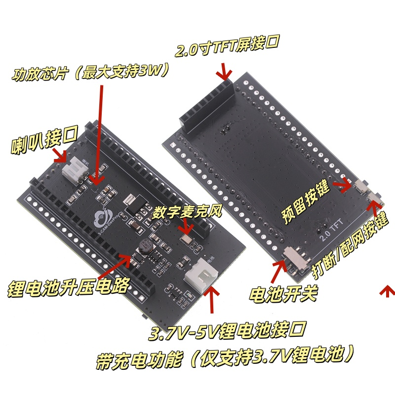

# 用自己的同款硬件运行 V2M

更新日期：2026-11-01。适用于朋友第一次组装、烧录，以及她的 Agent 协助排查。开发背景和实现细节见 [Agent 交接说明](AGENT_HANDOFF.md)。

完成后，短按拍照键会拍一张照片、在屏幕显示这张照片，再播放约 5–8 秒的旋律；扫描线随播放从左向右移动。第二个按键可重播、开关鼓点。v0.3.0 已在原设备运行，原用户最后确认“都正常，能听出鼓点变化”。这不代替新设备的接线和运行检查。

## 1. 先认清部件

| 部件 | 本项目已验证的配置 |
| --- | --- |
| 主板 | GOOUUU ESP32-S3-CAM **V1.5**，有摄像头、两个 USB-C 口、BOOT 和 RST |
| 扩展底板 | S3-CAM-DevPro **V2.0**，有主板插座、喇叭接口、屏幕接口和两个功能键 |
| 屏幕 | ST7789，竖向 **240×320**，8 针 SPI 接口 |
| 喇叭 | 接到底板标有“喇叭”的接口，由底板功放驱动 |
| 主控内存 | 原设备实测 16 MB Flash、8 MB PSRAM；新设备需要重新识别 |
| 供电 | 首次使用 USB 数据线供电，不接电池 |

V1.5 和 V2.0 分别是主板与底板版本，不是版本冲突。原商品资料写过 OV2640，但原设备启动日志实际识别为 **OV3660，PID `0x3660`**；新设备以自己的启动日志为准，不要因为商品名称直接改相机驱动或 GPIO。

下面是商家提供的底板正反面及接口位置图。图中“预留按键”就是本固件的 BUTTON2，“打断/配网按键”就是 BUTTON1。



可对照[原设备部件照片](../assets/IMG_9927.JPG)和[商家完整安装视频](../vendor/goouuu-s3-cam/hardware/CAM扩展板套件安装视频.mp4)。视频后段展示屏幕安装；实际连接始终以接口丝印和针脚逐一对应为准。

## 2. 断电后，按顺序连接

**拔掉所有 USB 线；若已连接电池，也先断开电池。** 以下插拔都在断电时进行。

1. **将主板叠插到底板。** 两排主板排针插入底板的两排长插座，镜头朝外。主板的双 USB-C 口朝底板“电池”接口及开关所在的一端，主板天线朝“喇叭”接口所在的一端。先对齐两排的首尾位置，再平直插入，确认两侧没有错开一格、悬空或歪针。底板不是另一块需要烧录的主控，必须与主板连接才能接收到音频和屏幕信号。
2. **连接喇叭。** 喇叭插头插入标有“喇叭”的白色插座。另一个标有“电池”的白色插座用于电源，不能接喇叭。首次复现不用电池；底板电池滑动开关也不是拍照或重播键。
3. **连接屏幕。** 屏幕显示面朝外，与摄像头镜头朝相反方向。先找屏幕板和底板插座的 **GND**，让 GND 对 GND，再检查整排 8 针，没有反插或错位。不要仅凭插头能插进去判断方向。
4. **最后连接电脑。** 使用能传数据的 USB-C 线，接主板的 **TTL / CH340** USB-C 口。使用电脑识别结果核实，方法见下一节。

屏幕针脚对照如下；SCL/SDA 等屏幕丝印在这里表示 SPI 时钟/数据，不是相机的 I²C 接口。

| 屏幕针脚顺序 | 常见屏幕丝印 | 底板连接 |
| --- | --- | --- |
| 1 | GND | GND |
| 2 | VCC | 3.3 V |
| 3 | SCL / SCK / CLK | GPIO19 |
| 4 | SDA / MOSI / DIN | GPIO20 |
| 5 | RES / RST | GPIO21 |
| 6 | DC | GPIO47 |
| 7 | CS | GPIO45 |
| 8 | BL / BLK | GPIO38 |

若你的屏幕针脚顺序或主板/底板版本与上表不同，先核对自己的资料，不要按这个顺序强接。原理图和全部引脚依据见 [HARDWARE.md](../HARDWARE.md) 与[商家资料索引](../vendor/goouuu-s3-cam/README.md)。

## 3. 确认用的是 TTL 串口

两个 USB-C 口可能都能被电脑识别，但本固件的日志、命令和复现流程使用 **CH340 串口**。

| 电脑识别结果 | 含义与处理 |
| --- | --- |
| USB Serial / CH340，常见 VID:PID `1a86:7523` | 本流程使用的 TTL 口 |
| Espressif USB JTAG/serial，常见 VID:PID `303a:1001` | 原生 USB 口；换到另一个 USB-C 口 |
| 没有新设备 | 换数据线、电脑接口；检查 CH340 驱动和系统串口权限 |

macOS 的端口可能形如 `/dev/cu.usbserial-…`，Linux 可能为 `/dev/ttyUSB…`，Windows 为 `COM…`。这些名称由电脑分配，**不要复制原设备的 `/dev/cu.usbserial-110` 当作自己的端口**。安装下一节的 Python 依赖后，可以用下面的只读命令列出端口：

```sh
.local/venv/bin/python -m serial.tools.list_ports -v
```

屏幕已经使用 GPIO19/20，因此不要在这个固件中同时启用原生 USB CDC/USB JTAG；继续使用 CH340 即可。

## 4. 取代码、安装工具，并备份自己的板子

```sh
git clone https://github.com/Zouu-X/img2music.git
cd img2music
```

先按 [SETUP.md](SETUP.md) 安装 Python 环境、Arduino CLI 和固定版本的 ESP32 平台。下面是 macOS / Linux 的命令，在仓库根目录执行，直接使用项目 Python 环境，无需激活。原开发机实际验证的是 macOS；Windows 上 Python 和 Arduino CLI 可原生运行，Python 路径通常改为 `.local/venv/Scripts/python.exe`，`.sh` 脚本需要合适的 shell。若用 Git Bash 或 WSL，还需按安装文档处理路径和串口可见性，不能视为已经通过 Windows 实机验证。

先把下方端口示例替换成上一节查到的真实端口。这一变量只供本终端后续命令使用：

```sh
# 示例仅表示 macOS 的命名方式，请替换为自己的完整端口名
V2M_PORT=/dev/cu.usbserial-自己的设备
.local/venv/bin/python tools/prepare_device.py --port "$V2M_PORT" --backup
.local/venv/bin/python tools/prepare_device.py --check-profile
```

第一条识别当前 ESP32-S3、MAC 和 Flash 容量，完整读取并校验**这块板自己的 Flash 备份**，生成本地设备配置 `.local/device.json`；第二条检查本地配置。保存终端报告的备份及元数据路径；完整读取可能需要数分钟。这一步会让设备进入下载模式，不写新固件。

`.local/device.json`、MAC、完整备份与设备一一对应。不要拿原作者或朋友另一块板子的配置/备份代替，也不要把完整 Flash 备份推到公共仓库。若识别、容量、备份校验或分区检查失败，保留错误输出，先查明差异。

本项目的保留式烧录流程只支持已核对的原布局：NVS `0x9000/0x6000`、PHY `0xf000/0x1000`、`factory` 应用 `0x10000/0x100000`（地址/大小，应用容量 1 MiB）。同款商品不保证出厂分区相同。工具遇到不兼容布局会拒绝烧录，不应靠删掉检查、整片擦除或复制原设备分区表来继续。

## 5. 测试、构建与烧录

关闭其他串口监视器；备份、烧录和监视工具不能同时占用同一端口。

```sh
sh tools/test.sh
.local/venv/bin/python -m unittest discover -s tests -p 'test_device_profile.py'
sh tools/build.sh
FLASH_PYTHON=.local/venv/bin/python FLASH_PORT="$V2M_PORT" sh tools/flash.sh
```

离线测试检查作曲、合成和按键逻辑，Python 测试检查设备配置及分区校验；构建生成当前源码的固件。烧录脚本使用上一步为自己设备生成的配置，重新核对身份和分区，只写应用并独立校验。它不需要改动出厂启动程序、NVS 或整片擦除。端口改变时可以更新 `V2M_PORT` 并通过 `FLASH_PORT` 指定，但仍须匹配该配置中的设备身份。不要使用早期历史版本中硬编码原作者 MAC、路径和备份的 `flash.sh`，也不要仅为了通过检查把它们替换成未经核对的值。

烧录后若没有出现等待拍照状态，先确认仍连接 CH340，释放 BOOT，短按主板 RST 复位后读取日志。原设备曾在一次烧录后的首次自动查询中无响应，复位后正常；当时原因未查明，不能据此认定所有“无响应”都只需复位。

## 6. 先验证流程，再实际按键试听

```sh
.local/venv/bin/python tools/monitor.py --port "$V2M_PORT" --send s --seconds 3
.local/venv/bin/python tools/device_check.py --port "$V2M_PORT" --cycles 2 --require-display --out build/device-check.log
.local/venv/bin/python tools/check_controls.py --port "$V2M_PORT" --out build/controls-check.log
```

后两条会实际拍照、播放和发送控制命令。正常状态应包含 `camera=1 audio=1 display=1`；完成后 `playing=0`、`underruns=0`，播放完成计数增加。`audio=1` 只表示驱动初始化成功，仍需要人确认喇叭确实有声音。

接着脱离自动命令，用真实按键检查：

| 操作 | 应看到/听到的行为 |
| --- | --- |
| 正常启动后短按主板 BOOT 或底板 BUTTON1 | 拍照，屏幕更新同一张照片，然后播放；扫描线向右移动 |
| 短按底板 BUTTON2“预留按键” | 使用上一张照片的音乐从头重播，不重新拍照；播放中也可使用 |
| 按住 BUTTON2 约 650 ms | 鼓点开/关切换一次；屏幕状态变化，开启后后续节拍加入鼓点 |
| 长按后松开 | 不应额外触发一次重播 |
| 播放时再次按拍照键 | 报告忙碌，不排队拍下一张 |
| 播放结束后再拍不同画面 | 替换照片并重新作曲 |

BOOT 和底板 BUTTON1 连接同一个 GPIO0，所以是同一功能；BUTTON2 使用 GPIO46。不要在上电/复位时按住 BOOT。鼓点默认关闭，开关状态保留到本次运行后续重播；复位后恢复关闭。RST 用于复位，没有被改作音乐按钮。

串口波特率为 115200，命令为 `c` 拍照播放、`p` 从头重播、`d` 鼓点开关、`x` 停止、`s` 状态、`j` JPEG 导出。还没拍照就重播会提示先拍照。诊断导出新照片可用：

```sh
.local/venv/bin/python tools/capture.py --port "$V2M_PORT" --out build/camera.jpg
```

`j` 导出不会替换当前屏幕上用于作曲的照片。当前音乐和照片保存在内存，断电后不会作为作品自动保存。

## 7. 遇到问题时

| 现象 | 先检查 |
| --- | --- |
| 没端口或无日志 | 数据线、CH340 口、真实端口名、115200 波特率、是否有别的工具占用串口 |
| 停在下载模式 | 释放 BOOT/BUTTON1，再按 RST；不要改 eFuse |
| `camera needs PSRAM` | 固定 ESP32 平台版本、OPI PSRAM 构建配置、自己的芯片容量 |
| 相机初始化失败 | 断电后检查摄像头连接及主板型号；记录错误码和传感器 PID，不根据商品标题猜传感器 |
| 屏幕不亮/花屏 | 断电检查 8 针 GND 与顺序；核对 ST7789 240×320 和 `DISPLAY error`；确认没有使用原生 USB |
| 显示完成但无声音 | 断电检查主板与底板两排连接、喇叭插座、喇叭线；`audio=1` 不能证明已出声 |
| 第二按键不工作 | 找图中的“预留按键”；查看状态 `key2`，空闲应为 1；不要把电池开关或 BUTTON1 当作第二独立键 |
| `audio underrun` | 当前播放会停止；保存日志，重播观察，并检查新增的耗时操作；不要屏蔽该错误后继续宣称同步正常 |
| 身份、容量或分区检查不通过 | 保留自己设备的识别结果，交给 Agent 按 [交接说明](AGENT_HANDOFF.md) 核对；不要强行烧录原设备备份 |

请记录自己的硬件照片、工具版本、传感器 PID、错误日志及实际听音结果。原设备验证记录在 [VALIDATION.md](VALIDATION.md)，新的结论应单独记录，不能把原设备的内存读数、MAC 或成功次数复制成新设备结果。
